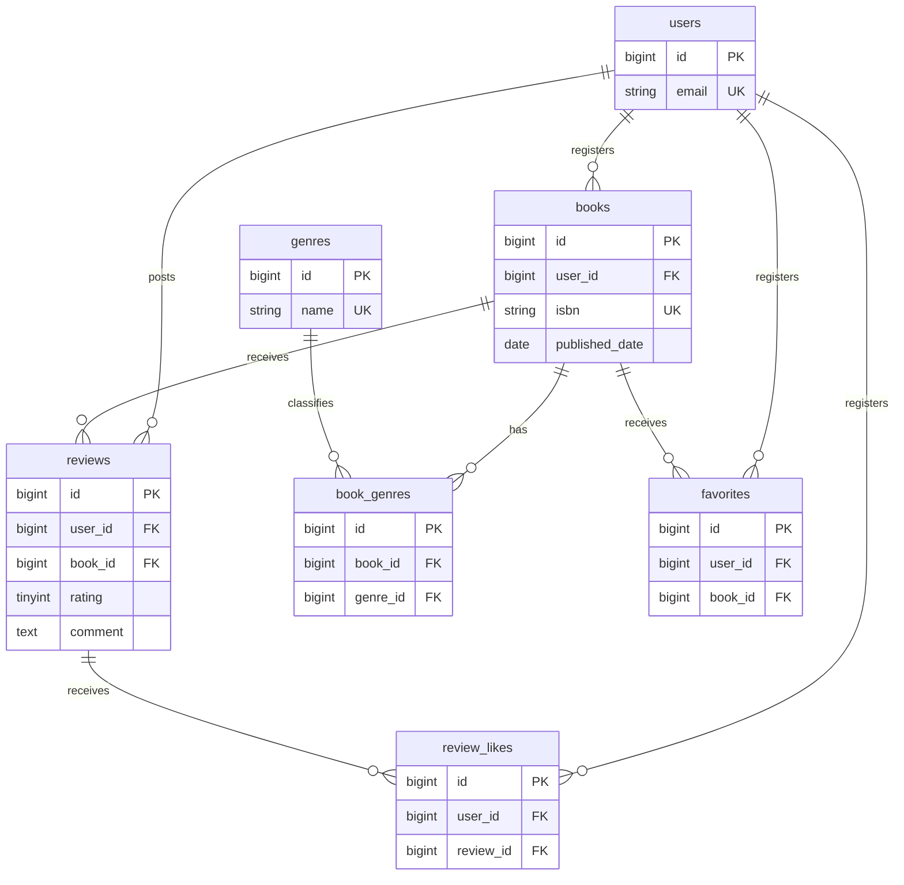

# 基本DB設計・ER図

> Issue #79（2026-11-26）の出版日変更は末尾節と[MS13統合記録](ms13-integration-verification.md)を参照。
> 基本版の実DB照合結果は過去の履歴。#79の開発DB適用結果と復旧の確認範囲はMS13統合記録を参照。

## 1. 対象と根拠

- 記録日：2026-11-20
- 関連Issue：#56
- 要件資料：Bookshelf要件シート20261114版
- 参照：シート11・12、関連PM回答
- 対象：基本機能の実装済み業務テーブル

現行Migration・Model・MySQLのテーブル定義を
最終照合した結果に基づいて記録する。

公式のテーブル仕様書を置き換えるものではない。

## 2. ER図

ER図には関連を理解するための主要カラムを記載する。
全カラムの型・桁数・NULL制約等は、
公式テーブル仕様書とMigrationを参照する。

## 3. テーブル構成

| テーブル | カラム数 | 役割 |
|---|---:|---|
| users | 11 | 会員 |
| books | 10 | 書籍 |
| genres | 4 | ジャンル |
| reviews | 7 | レビュー |
| book_genres | 5 | 書籍とジャンルの関連 |
| favorites | 5 | 会員のお気に入り書籍 |
| review_likes | 5 | 会員のレビューいいね |
| 合計 | 47 | |

Laravelの標準管理テーブルは上記ER図から省略する。
応用機能の追加テーブルは未実装のため含めない。

## 4. 外部キーと削除時動作

| 参照元 | 参照先 | ON DELETE |
|---|---|---|
| books.user_id | users.id | RESTRICT |
| reviews.user_id | users.id | RESTRICT |
| reviews.book_id | books.id | CASCADE |
| book_genres.book_id | books.id | CASCADE |
| book_genres.genre_id | genres.id | RESTRICT |
| favorites.user_id | users.id | RESTRICT |
| favorites.book_id | books.id | CASCADE |
| review_likes.user_id | users.id | RESTRICT |
| review_likes.review_id | reviews.id | CASCADE |

書籍削除時は関連レビュー・ジャンル紐付け・
お気に入りが削除される。
レビュー削除に伴い、そのレビューへのいいねも削除される。

書籍に紐付くジャンルの削除は許可しない。

## 5. 主要なDB制約

### 一意制約

- users.email
- books.isbn
- genres.name
- book_genres：book_idとgenre_idの組み合わせ
- favorites：user_idとbook_idの組み合わせ
- review_likes：user_idとreview_idの組み合わせ

### 入力値・NULL制約

- reviews.rating：1〜5のCHECK制約
- reviews.comment：NULL許容
- books.published_date：NULL許容（Issue #79の新規Migration適用後。基本版はNOT NULL）
- books.description・image_url：NULL許容

usersの2FA関連3カラムはNULLを許容する。
基本版では2FA機能を有効化していない。

### 業務上の制約との区別

- 同一ユーザーによる同一書籍への複数レビューを許可する。
- 自己登録書籍のお気に入り登録を許可する。
- 自己レビューへのいいねを許可する。
- レビュー編集時のコメント必須化はFormRequestで扱う。

## 6. 検証記録

- Model4クラス、リレーション12定義を確認。
- 基本業務7テーブルの定義・主要制約を照合。
- Migration11本の適用状況を確認。
- DB制約・リレーション・Seederの回帰検証を実施。
- ジャンル登録・更新・削除の障害時ロールバックを検証。

テーブル構造を変更する場合は、
公式要件・Migration・Model・本資料・関連テストを
併せて確認する。

## 7. 関連資料

- [README](../README.md)
- [MS10モデル・DB関連検証記録](ms10-model-verification.md)
- [MS10最終統合検証記録](ms10-final-verification.md)

## Issue #79：books.published_dateのNULL許容

- 公式20261121版シート11 G14とユーザー承認に基づき、新規2026_11_26_000000_make_books_published_date_nullable.phpを追加する。既存create_books_tableの定義は履歴として保持する。
- DATE型、既存日付、他カラム、一意制約、外部キー、関連データは変更しない。MySQL標準DDLを使用し、追加依存は不要とする構成。
- downはNULL行があれば理由の分かる例外で停止する。NULLなしの場合だけNOT NULLへ戻し、削除や架空日付の補完はしない。実復旧は並行書き込みを停止し、データと対象Migrationを確認する別工程。
- 保存検証の任意化はDBのNULL許可と区別する。Web/API登録省略はNULL、更新省略は保持、明示空値はNULLという保存仕様は今回のユーザー承認済み設計。H077のPM回答済みとは扱わない。
- Bookのdateキャスト、既存のNULL対応表示を維持する。API Resourceの日付変換だけをNULL対応にする。提供Bladeの必須マークは表示制約として残す。
- Migrationテストはtesting内の接頭辞付き専用テーブルに隔離する。通常業務テーブルとMigration履歴には触れず、DDL後の片付けと接続復元をfinallyで行う。ユーザー実行の隔離テスト結果はMS13統合記録を参照。
- ユーザー共有では開発DBへの適用後に出版日のNULL許可とMigrationのRanを確認した。開発DBの全データ比較・実rollback・バックアップ復元は未実施。
